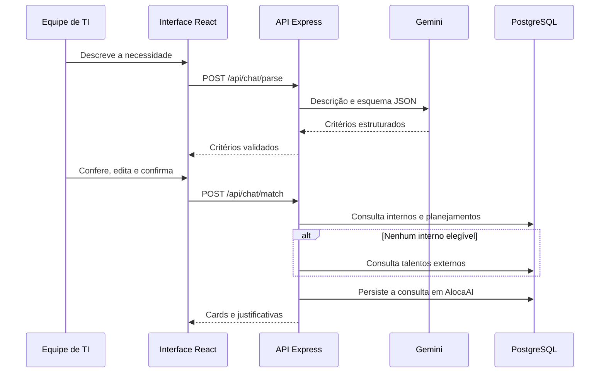

# Arquitetura e decisões

## Componentes

| Camada | Arquivos | Responsabilidade |
|---|---|---|
| Interface | `src/main.tsx`, `src/style.css` | Chat, critérios, cards, histórico e pedidos |
| Inicialização | `scripts/start.mjs`, `server/index.ts` | Ambiente, banco, persistência, Vite e servidor |
| API | `server/app.ts` | Contratos HTTP, orquestração, erros e origem |
| IA | `server/ai.ts` | Adaptadores Gemini/OpenAI, JSON estruturado e Zod |
| Regras | `server/matching.ts` | Normalização, elegibilidade, notas e ordenação |
| Fonte | `server/database.ts`, `server/dump.ts` | Consulta PostgreSQL ou leitura explícita do snapshot |
| Persistência | `server/storage.ts` | Schema AlocaAI ou arquivo no modo snapshot |

## Decisões do MVP

1. A IA interpreta texto; ela não gera SQL, escolhe candidatos nem modifica alocações. As justificativas são construídas com dados e regras determinísticas.
2. Skills são comparadas por normalização e equivalências explícitas. Não há embeddings, busca vetorial nem inferência de que uma tecnologia relacionada comprova uma obrigatória.
3. A base fornecida representa os sistemas de origem, mas não há conexão ativa com o SGD corporativo. As consultas normais usam PostgreSQL importado do pacote.
4. As tabelas do desafio permanecem em `InHire`. Histórico e pedidos ficam em `AlocaAI`. A migração é transacional e serializada com advisory lock; importação do legado é idempotente.
5. A solicitação é um registro pendente. A unicidade por consulta/candidato evita duplicatas simultâneas, mas não evita duas demandas diferentes sobre a mesma pessoa, pois não há reserva real de capacidade.
6. Snapshot é uma escolha explícita. Falha no PostgreSQL não dispara leitura de arquivo nem consulta externa silenciosa.

## Execução e fronteiras

Express e Vite compartilham a porta em desenvolvimento. Na compilação, Express serve `dist/`. O servidor escuta em `127.0.0.1`; Docker publica PostgreSQL também somente em loopback. Não há login, perfis de acesso, multitenancy nem trilha de aprovação real.

Somente a descrição digitada é enviada ao provedor selecionado. Perfis, histórico e resultados permanecem locais. A interface nunca recebe a chave. `/api/status` informa configuração, não garante disponibilidade nem saldo da IA. O adaptador rejeita respostas inválidas, bloqueadas e incompletas. Não há troca automática de provedor.
